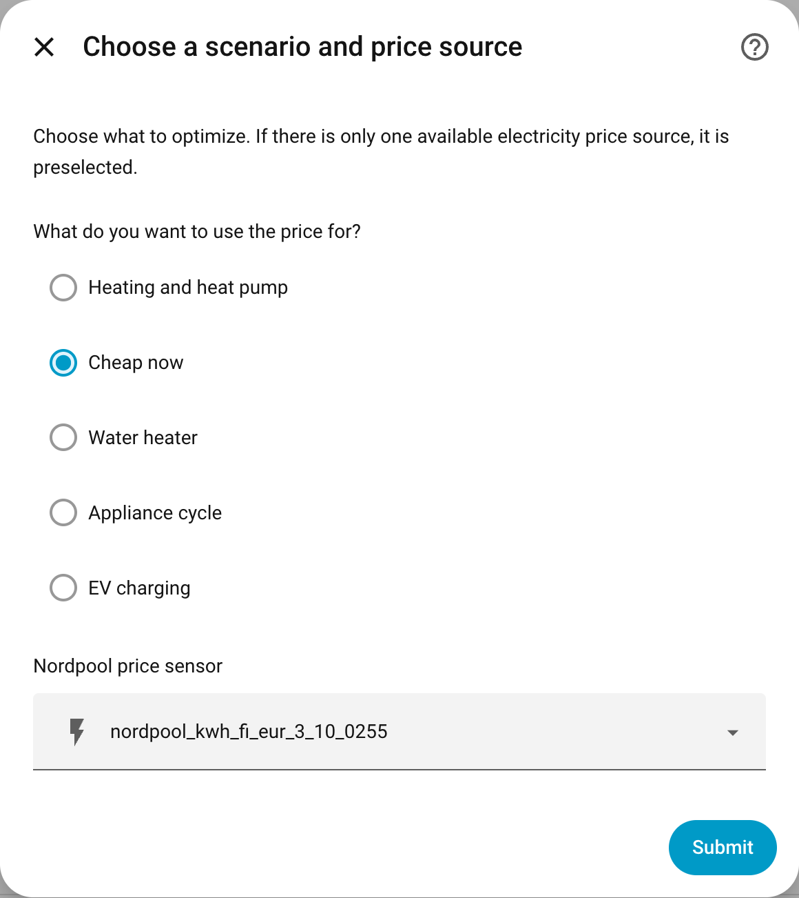
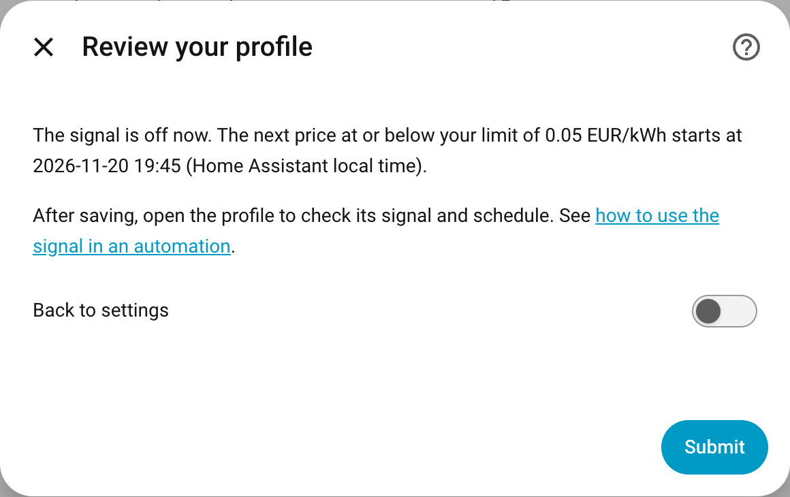

# Install and configure Electricity Price Scheduler

## Availability

The integration is in local development. It has not been released on GitHub, submitted to the Home Assistant Marketplace, or validated as a production installation. Do not add a GitHub Marketplace repository or install this version into a production Home Assistant instance.

The implementation targets Home Assistant 2026.11.0. The current local test setup uses the arm64 HA 2026.11.0 container described in [local testing](development/local-testing.md). This target is not yet a promise of a released minimum version.

## Before you start

Set up one [supported electricity price source](configuration.md#profile-and-price-source) in your Home Assistant instance. Check that it has a current price for your area. If you already use the community Nord Pool integration, you can start with its existing price sensor. Choose English under **User profile → Localization → Language** to match the labels below.

## Marketplace installation

Use Home Assistant 2026.11 or later and wait for the first v3 integration release in [GitHub Releases](https://github.com/nikopaulanne/electricity-price-scheduler/releases). Versions 1.x and 2.x are for the legacy Python Script.

1. Select [Open Electricity Price Scheduler in Marketplace](https://my.home-assistant.io/redirect/marketplace_repository/?owner=nikopaulanne&repository=electricity-price-scheduler&category=integration). Confirm the address of your Home Assistant instance if asked.
2. If Marketplace offers to add the repository, follow the prompts. Connect GitHub if prompted, then return to Home Assistant and open the repository page.
3. Select **Install** and confirm that the dialog shows an integration release (v3 or later). To pick a specific release, follow [Installing another version](https://www.home-assistant.io/integrations/marketplace/#installing-another-version).
4. Follow any restart prompt, then [create your first profile](#create-your-first-profile). If you are moving from the Python Script, use the [migration guide](migration.md) before connecting any equipment.

If the link does not open your instance, go to **Settings → Marketplace → Add from link** and enter `https://github.com/nikopaulanne/electricity-price-scheduler`. If prompted for the type, select **Integration**. Select **Add**, then open the repository page and continue at step 3.

See [Home Assistant’s Marketplace guide](https://www.home-assistant.io/integrations/marketplace/) for version selection, updates and uninstalling. The published release will state the exact Home Assistant requirement and tested sources.

## Create your first profile

1. If setup is already open, continue there. Otherwise open **Settings → Devices & services → Helpers → Create helper** and choose **Electricity Price Scheduler**.
2. Choose **Cheap now** and select your price source. If Home Assistant has one available source, the form preselects it. Check that it is the sensor or market area you use, then select **Submit**.
3. Enter a **Cheap price limit** in the currency and unit shown. Enter `0.05` for 5 euro cents per kWh when the form shows EUR/kWh. Select **Submit**, review the preview, and select **Submit** again with **Back to settings** off. Select **Skip and finish** if Home Assistant offers to assign the device to an area.
4. Go to **Settings → Devices & services → Integrations → Electricity Price Scheduler** and open the profile's device (for example, **Cheap electricity**). Check **Current price**, **Schedule status**, and **Use electricity now**. With valid prices and no time restrictions, the signal is **On** at or below the limit and **Off** above it. If the status is **Price source unavailable** or **Invalid price data**, see [Unknown or unavailable values](troubleshooting.md#unknown-or-unavailable-values).

## Choose what to schedule next

- [Try the signal with a Toggle helper](scenarios.md#try-the-signal-with-a-toggle-helper) before [connecting a switch](scenarios.md#first-example-with-a-switch).
- [Run a water heater for the cheapest three hours overnight](scenarios.md#run-a-water-heater-for-the-cheapest-three-hours-overnight), or use the **EV charging** scenario to plan charging within a window you choose.
- [Compare heating schedules and keep a way back](migration.md) if you are replacing the Python Script.

## Interface language

Choose English, Finnish, Swedish, or German under **User profile → Localization → Language**. This controls the setup and translated states in your interface. Home Assistant uses the installation language under **Settings → System → Home information** for default entity names and the suggested name for a new profile. Existing profile names are saved as entered. You can change the display name in Home Assistant while keeping the same entity ID.

## Local development instance

Follow [Local Home Assistant development](development/local-testing.md) to load the development code into an isolated test instance. Once it is running, start at [Create your first profile](#create-your-first-profile).
